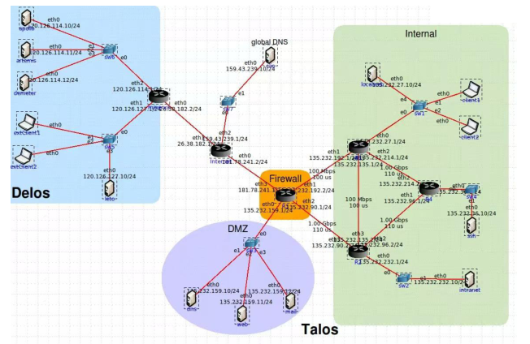

# Network Architecture, Routing and Firewall Security (FIT9137)

A simulated enterprise network implementation built in **CORE Network Emulator**, covering multi-router connectivity, DHCP address assignment and restrictive firewall policies. This portfolio version is based on the original `.imn` simulation project and technical report.

## Project overview

The topology models two administrative domains (**Delos** and **Talos**), a simulated Internet connection, internal hosts, service servers and a DMZ. The Talos border router (R3) enforces firewall rules between the DMZ, internal networks and outside connections.

## Implemented work

- **Routing:** Configured static and default routes on simulated routers. Selected alternative paths based on hop count and link bottlenecks; verified connectivity and paths using `ping` and `traceroute` in the report.
- **DHCP:** Configured DHCP for client interfaces, retaining static addressing for designated servers. Examined DHCP traffic after client-service restarts.
- **Firewall:** Applied default-DROP policies and stateful `conntrack` return-traffic rules on R3; permitted selected DNS, HTTP, HTTPS, SMTP, SSH and ICMP traffic according to network zones.
- **Validation:** Used terminal observations including `ping`, `traceroute`, `wget`, `dig` and SSH connection attempts to check expected access and isolation.

## Repository contents

| Path | Description |
| --- | --- |
| `core-project/network_topology.imn` | Editable CORE Emulator network project (personal student-ID label removed) |
| `configs/r3_firewall.sh` | Firewall rules extracted from the original CORE R3 service |
| `configs/static_routes.txt` | Route commands extracted from router services |
| `configs/dhcp_examples.txt` | DHCP subnet declarations taken from the topology |
| `assets/network_topology.png` | Overview illustration from the project report, with student ID obscured |

## Tools and concepts

**CORE Network Emulator**, Linux networking, IPv4/subnetting, static routing, DHCP, `iptables`, `conntrack`, DMZ segmentation, TCP/UDP service ports, network troubleshooting.

## Reproduction and limitations

To inspect or attempt to run the full topology, open `core-project/network_topology.imn` in a compatible CORE Emulator installation. Runtime behavior depends on the CORE version, installed host services and the simulation environment. The extracted configuration files are **examples from the simulation**, not production-ready deployment instructions. This portfolio package has not been re-executed in CORE; validation statements above reflect the submitted project report. A few addressing inconsistencies between report prose and the saved simulation may need review before reuse.

The full submitted PDF is not included to avoid exposing personal details and to keep this project focused on the technical implementation.
